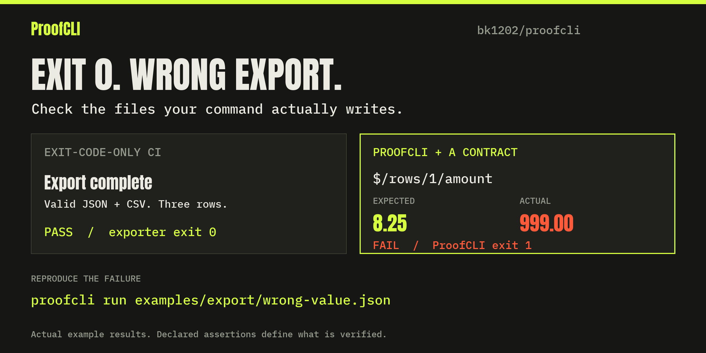

<div align="center">

# ProofCLI

### A command can exit successfully and still produce the wrong result.

Run the command. Check its files. Report what passed and what failed.

[](https://github.com/bk1202/proofcli/actions/workflows/ci.yml)
[](https://www.python.org/downloads/)
[](pyproject.toml)
[](LICENSE)

**Windows · macOS · Linux · JSON contracts · Human and JSON reports**

[Quick start](#quick-start) · [See it fail](#see-it-fail) · [Checks](#what-you-can-check) · [Documentation](#documentation) · [Limitations](#limitations)

</div>

---



The [broken exporter](examples/export/export.py) prints “Export complete” and exits `0`. Its JSON and CSV contain the wrong amount. The [contract](examples/export/wrong-value.json) checks the records and fails with this difference in the actual report:

```json
{
  "path": "$/rows/1/amount",
  "reason": "value or type differs",
  "expected": "8.25",
  "actual": "999.00"
}
```

**[Reproduce this failure](#see-it-fail)** · [Install from PyPI](#quick-start) · [Add the GitHub Action](#github-action)

ProofCLI tests the output of command-line tools. Give it a command and a JSON contract: the expected exit code, log patterns, output files, and their contents. It runs the command in a fresh temporary directory and returns a report and an exit code you can use in CI.

Use it for an exporter that drops records, a generator that writes an empty file, or an automated workflow that prints “done” before producing the expected result. A passing check means the declared assertions passed. The quality of those assertions still matters.

## Quick start

Use a virtual environment with an existing Python installation. Releases contain a universal wheel, source distribution, and SHA-256 checksums. This is not a standalone executable.

Windows (PowerShell):

```powershell
py -3 -m venv .venv
.venv\Scripts\python -m pip install proofcli==0.4.1
.venv\Scripts\proofcli --help
```

macOS:

```sh
python3 -m venv .venv
.venv/bin/python -m pip install proofcli==0.4.1
.venv/bin/proofcli --help
```

Use the environment's `python -m proofcli` if the console command is not on PATH. From a checkout, use `python -m pip install .`. The [GitHub release](https://github.com/bk1202/proofcli/releases/tag/v0.4.1) also provides a wheel, source archive, and checksums. PyPI uploads follow successful GitHub release validation; see the [publishing workflow](https://github.com/bk1202/proofcli/actions/workflows/pypi.yml) for index availability.

### Run your first contract

The examples below assume the environment's executables are on PATH; otherwise use their full paths as above.

```console
proofcli init proofcli.json
proofcli validate proofcli.json
proofcli run proofcli.json --report verification.json --artifacts evidence
```

`init` writes a working example without executing it. `validate` checks the schema, not dependency availability. `run` executes and verifies. The legacy `proofcli SPEC` form still works.

Artifact directories must be new. Reports are replaced atomically when explicitly reused; the spec, input sources, and retained output paths are protected. Failed files are preserved with `--artifacts`. `--json` emits one JSON object on stdout; child logs stay inside its fields.

## See it fail

With ProofCLI [installed](#quick-start), clone the repository and run the failing contract:

```console
git clone https://github.com/bk1202/proofcli.git
cd proofcli
proofcli run examples/export/wrong-value.json
```

**Expected outcome: ProofCLI exits `1`, while the exporter exits `0`.** The exporter creates valid, nonempty JSON and CSV, silently changing Grace's amount to `999.00` while keeping the original total. Its success message, row-count check, and JSON summary check still pass. Exact record assertions identify `$/rows/1/amount`: expected `8.25`, actual `999.00`.

Run the correct exporter for comparison, or keep the failed files and report for inspection:

```console
proofcli run examples/export/good.json
proofcli run examples/export/wrong-value.json --report bad-report.json --artifacts bad-output
```

| Example | What goes wrong despite exit code `0` |
| --- | --- |
| [Wrong field value](examples/export/wrong-value.json) | A record disagrees with the expected amount. |
| [Missing record](examples/export/missing-record.json) | A record is dropped while the summary still claims three. |
| [Unexpected column](examples/export/extra-column.json) | The CSV contains a column the contract forbids. |
| [Empty export](examples/export/false-success.json) | The exporter reports success without the required records. |

These examples execute the exporter against a checked-in CSV fixture. `--report` saves the checks and logs; `--artifacts` keeps the files for inspection.

## What you can check

| Check | Contract option |
| --- | --- |
| Exit code and execution deadline | `expect.exit_code`, `timeout_seconds` |
| Patterns in stdout and stderr | `stdout_regex`, `stderr_regex` |
| Regular output files and minimum byte size | `files[].path`, `min_size` |
| Patterns in file text | `text_regex` |
| Selected JSON fields | `json_contains` |
| Exact JSON values, keys, and ordered arrays | `json_equals` |
| CSV columns and minimum row count | `csv.columns`, `csv.min_rows` |
| Exact CSV headers and ordered records | `csv.exact_columns`, `csv.rows` |

### A contract

This example stages a fixture, runs the exporter, and checks every CSV record:

```json
{
  "version": 1,
  "argv": ["{python}", "{spec_dir}/export.py", "input.csv", "report.json"],
  "inputs": [{"source": "fixtures/input.csv", "dest": "input.csv"}],
  "timeout_seconds": 10,
  "verification_timeout_seconds": 5,
  "expect": {
    "exit_code": 0,
    "files": [{
      "path": "report.csv",
      "csv": {
        "columns": ["id", "customer", "amount"],
        "exact_columns": true,
        "rows": [
          {"id": "1", "customer": "Ada", "amount": "12.50"},
          {"id": "2", "customer": "Grace", "amount": "8.25"},
          {"id": "3", "customer": "Linus", "amount": "13.00"}
        ]
      }
    }]
  }
}
```

Save it beside `examples/export/export.py`, or start with the [complete good contract](examples/export/good.json). Specs use JSON; YAML is not supported. CSV values are strings. JSON booleans do not equal numbers; output decimals are compared without binary float rounding.

`argv` has **no implicit shell**, variable expansion, pipes, or globbing. `{python}` selects ProofCLI's interpreter, preserving its virtual environment. `{spec_dir}` and `{work_dir}` expand inside arguments. Windows batch files are rejected; invoke an interpreter explicitly when shell behavior is intentional.

See the [complete specification](docs/specification.md), [report format](docs/reports.md), and [use cases](docs/use-cases.md).

## Exit codes and CI

### GitHub Action

After checking out your repository, add one step:

```yaml
steps:
  - uses: actions/checkout@v7
  - uses: bk1202/proofcli@v0.4.1
    id: proof
    with:
      spec: tests/export-contract.json
```

The Action sets up Python and runs the ProofCLI source bundled at that version. It requires no separate pip install and fails the step when verification fails. It exposes `report`, `status`, and `exit-code` outputs and writes a job summary. Use a full commit SHA instead of a tag when your workflow requires an immutable dependency.

Optional `report` and `artifacts` inputs choose where evidence is saved. Upload reports with your CI's artifact step if you want them retained after the job. See the [Action guide](docs/github-action.md) for a complete workflow and failure handling.

The [broken exporter workflow](.github/workflows/demo.yml) is intentionally red: its exit-code-only job passes while the ProofCLI job fails. This demonstrates a weak CI check; CI with suitable pytest or shell assertions can catch the same defect.

### Exit codes

| Exit | Meaning |
| --- | --- |
| `0` | Every requested assertion completed and passed, or `init`/`validate` succeeded. |
| `1` | Command/expectation failure, timeout, output overflow, or assertion deadline exceeded. |
| `2` | Invalid usage/spec, supervision, file handling, or report I/O error. |
| `130` | Ctrl+C/SIGINT or Windows Ctrl+Break. |
| `143` | SIGTERM interruption. |

The child's actual exit code is separate; on POSIX a negative code indicates a signal. Check `status` and `verification_complete` before treating a report as evidence. Use your CI system's artifact mechanism to upload retained files/reports.

## Limitations

- Fresh directories prevent previous-run output from satisfying checks. Inputs are independent copies with byte counts/SHA-256 fingerprints. Output links/reparse points and hard-link aliases of staged inputs are rejected.
- Each stream is bounded to 1 MiB in memory; overflow stops the command. Logs are not first written to unbounded temporary files. Specs and semantic file reads are also capped at 1 MiB.
- Logs must be valid UTF-8. Invalid bytes fail capture and log assertions; reports retain the captured bytes as base64 plus decoding-error offsets. A handled interruption drains pending pipe bytes within the capture limit and a bounded wait.
- Assertions run in a separate supervised process with an independent deadline. A pathological regex cannot indefinitely block the CLI.
- Ordinary descendants are terminated on completion, timeout, and handled interruption: Job Objects on Windows, process groups on macOS. POSIX children that detach into another session can escape. SIGKILL, crashes, native uninterruptible I/O, and external filesystem races are not universally controllable.
- **This is not a security sandbox.** Commands inherit your environment and user permissions. They can access other files/network, modify external state, and create arbitrarily large output files. There are no general CPU, memory, network, or disk quotas. Reports may contain sensitive argv and logs.
- A pass proves only the declared properties of observed files and decoded logs. Weak assertions, unrepresentative fixtures, or an agent changing both code and expectations can still give false confidence. No visual, audio, business, or universal semantic correctness is established.

See the [audit](docs/audit-0.3.md) for confirmed defects and remaining limits, and [validation evidence](VALIDATION.md) for actual test results and skipped cases. The project has not had an independent third-party security review.

The [0.4 capture notes](docs/capture-0.4.md) document the invalid-byte false positive, interruption fix, and intentional compatibility change.

## Why not pytest or a shell script?

| Tool | Good fit | Tradeoff |
| --- | --- | --- |
| ProofCLI | Small, reviewable JSON contracts around real commands; consistent reports across Windows/macOS. | Limited assertion vocabulary and fixed resource policies. |
| pytest | Arbitrary Python assertions, rich fixtures, parametrization, plugins, and complex application tests. | Python test code and a pytest dependency; subprocess ownership/reporting must be chosen or implemented. |
| Shell scripts | Short checks with existing utilities and direct composition. | Quoting, utilities, cleanup, and reports vary across shells/platforms. |

ProofCLI can run inside pytest, a shell script, or CI. Choose a general test framework when the verification logic outgrows a declarative contract.

## Documentation

| Guide | Contents |
| --- | --- |
| [Specification](docs/specification.md) | Every contract field, path rule, placeholder, and resource limit. |
| [Reports](docs/reports.md) | Statuses, diagnostics, interruption handling, and exit codes. |
| [Use cases](docs/use-cases.md) | Choosing checks for exporters, generators, and workflows. |
| [Audit](docs/audit-0.3.md) | Defects found, regression coverage, and unresolved risks. |
| [Releases](docs/releasing.md) | Build, validation, checksums, and publication. |
| [Changelog](CHANGELOG.md) | Version history and compatibility changes. |

## Contributing

Bug reports should include a minimal contract, the expected result, and the actual report. Use a small reproducer that can be shared safely. See [CONTRIBUTING.md](CONTRIBUTING.md) for development setup and checks, and [SECURITY.md](SECURITY.md) for security reports.

```console
python -m pip install --require-hashes -r requirements-build.txt
python -m build --no-isolation
python tools/verify_dist.py
python -m pip install .
python -m unittest discover -s tests -v
```

CI exercises the installed wheel on Windows, macOS, and Linux, fresh wheel/sdist installations on Windows/macOS, and the composite Action on all three platforms. Build tools are hash-locked; Actions are pinned to commit IDs. [Release instructions](docs/releasing.md) describe validation, checksums, and PyPI publication.

See [CHANGELOG](CHANGELOG.md), [SECURITY](SECURITY.md), and [CONTRIBUTING](CONTRIBUTING.md). Licensed under [MIT](LICENSE).

Motivation included CLI-Anything issues [#406](https://github.com/HKUDS/CLI-Anything/issues/406) and [#407](https://github.com/HKUDS/CLI-Anything/issues/407). ProofCLI is independently implemented; no CLI-Anything code was copied.
